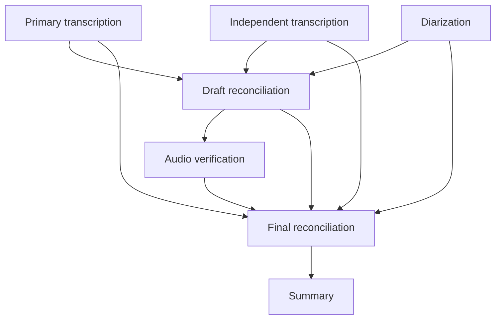

# Audio Transcriber

Transcribe recordings, identify speakers, reconcile alternative readings, and generate summaries. Reusable TOML profiles define the workflow; model TOML files select the API model and prompt for each stage.

Accepts a curated catalog of 26 ISO 639-1 languages with localized document labels, local caching, AMR conversion, and Markdown with searchable frontmatter. Danish and English are the tested workflows; other languages depend on the configured models and have not been quality-validated. Processing uses the OpenAI API. Python handles timing, metadata and document rendering locally.

## Start here

Requirements: **Python 3.11+**, Pipenv, and FFmpeg (including `ffprobe`) on `PATH`. Conversion and multipart audio need FFmpeg's `libmp3lame` encoder.

MP3, MP4, MPEG, MPGA, M4A, WAV, WebM, FLAC and OGG can be uploaded directly. Other extensions, including AMR, AAC and AIFF, are converted to MP3 if your FFmpeg build can decode them. Files must contain an audio stream with a readable duration. Conversion leaves the original unchanged.

Extract the entire project and open its directory. Install the locked dependencies:

```cmd
pipenv sync
```

In Windows Cmder using CMD:

```cmd
set /p OPENAI_API_KEY=Paste OpenAI API key:
```

Key entry is visible; `set OPENAI_API_KEY=` clears it from that terminal. In Bash:

```bash
read -rsp 'OpenAI API key: ' OPENAI_API_KEY; echo
export OPENAI_API_KEY
```

Pipenv uses your installed interpreter; the launcher checks the minimum Python version. If necessary, select one explicitly with `pipenv --python 3.12`. Keep the supplied `Pipfile.lock`; change dependencies intentionally with `pipenv update`.

## Languages

Set `language = "fr"` in a recording TOML or use `-l fr` on the command line. The default remains Danish (`da`), and a CLI language overrides the recording config. The accepted codes are a curated selection of officially assigned [ISO 639-1 two-letter codes](https://www.loc.gov/standards/iso639-2/php/code_list.php), not a popularity ranking or a list of all languages supported by the API.

| Code | Language   | Code | Language   |
| ---- | ---------- | ---- | ---------- |
| `ar` | Arabic     | `it` | Italian    |
| `bg` | Bulgarian  | `ja` | Japanese   |
| `bn` | Bengali    | `nl` | Dutch      |
| `cs` | Czech      | `no` | Norwegian  |
| `da` | Danish     | `pl` | Polish     |
| `de` | German     | `pt` | Portuguese |
| `el` | Greek      | `ro` | Romanian   |
| `en` | English    | `ru` | Russian    |
| `es` | Spanish    | `sk` | Slovak     |
| `fi` | Finnish    | `sv` | Swedish    |
| `fr` | French     | `tr` | Turkish    |
| `hi` | Hindi      | `uk` | Ukrainian  |
| `hu` | Hungarian  | `zh` | Chinese    |

Use lowercase codes exactly as listed. Three-letter codes, locale variants such as `en-US`, and automatic detection are not configuration options. `no` uses Norwegian Bokmål document labels, and `zh` uses Simplified Chinese labels; these are not dialect guarantees for the audio model.

British and American English both use `en` here. Their standard locale tags would be `en-GB` and `en-US`, not `en/uk` and `en/us`; `uk` alone is the language code for Ukrainian. Those variants mainly help choose spelling conventions for generated summaries, not a separate transcription language. For now, state a preference such as “Use British English spelling in summaries” in the recording's selected context file; do not rewrite faithfully transcribed speech to impose that spelling preference.

Summary headings, speaker/unknown-speaker labels, reconciliation notes, research headings/status/source labels, and unclear-speech markers are defined in [src/i18n.py](src/i18n.py). Transcription and text-stage requests receive the selected language name and marker. Editorial prompts and synthetic context labels such as `Unknown` remain English scaffolding; generated transcription/reconciliation stays in the spoken language, while summary/research prose uses the requested language. Names, source indices, timestamps, TOML keys, YAML frontmatter keys, CLI help, diagnostics, and output filenames are not translated.

```cmd
pipenv run python transcribe.py "recording.mp3" -l fr --plan
```

The catalog and translations are local configuration, not proof of audio-model support or transcription accuracy. Behavioral and mocked SDK tests focus on Danish and English; the remaining entries receive structural completeness checks only. Validate model support and review representative audio before relying on another language.

Localized document-label changes render from valid caches without API calls. Changes to language or effective prompt rules/unclear markers invalidate affected requests automatically; this multilingual update changes transcription/text prompts but leaves matching diarization caches reusable. `--redo all` is not needed for those changes.

## Run the reference example

The project includes a complete, fictional English call: Morgan complains to Riley at Tuber & Timber about an angry beaver in a potato delivery. The recording uses AI-generated voices and runs for about **5 minutes 7 seconds** (2.45 MB).

| File                                                             | Purpose                                           |
| ---------------------------------------------------------------- | ------------------------------------------------- |
| [tuber-and-timber-call.mp3](example/tuber-and-timber-call.mp3)   | The recording to transcribe                       |
| [tuber-and-timber-call.toml](example/tuber-and-timber-call.toml) | Recording settings: English, `standard`, Markdown and SRT |
| [context.md](example/context.md)                                 | Morgan's notes, names, and intended outcome       |

From the project root, check the configuration without API calls, then run it:

```cmd
pipenv run python transcribe.py -c example/tuber-and-timber-call.toml --plan
pipenv run python transcribe.py -c example/tuber-and-timber-call.toml
```

The processing command uses your OpenAI API key and incurs API charges. With the five-minute cap, this recording is split into two balanced parts. The example explicitly selects `standard`: transcription, diarization and reconciliation for each part, then one final combination and summary. That is **8 model calls on an uncached run**, before any SDK retries. The configured start timestamp is fictional example metadata.

Read the results in:

- `example/tuber-and-timber-call/tuber-and-timber-call.reconcile.md`
- `example/tuber-and-timber-call/tuber-and-timber-call.reconcile.srt`
- `example/tuber-and-timber-call/tuber-and-timber-call.summary.md`

Rerun the same command to reuse completed stages. The generated example directory is ignored by Git; the MP3, config and context are included in the project.

For your own recording, copy the example config and update its audio, context, language and start time, or run directly:

```cmd
pipenv run python transcribe.py "D:\recordings\call.amr" -l da -p standard
```

## Choose a workflow

Profiles describe the work performed, so the same profile can serve phone calls, meetings, interviews or voice notes. **`reviewed` is the default**, favoring extra audio checks over fewer calls. Recording purpose belongs in your context file.

| Profile      | Processing                                                                                                            | Use when                                                      |
| ------------ | --------------------------------------------------------------------------------------------------------------------- | ------------------------------------------------------------- |
| `quick`      | One transcription → summary                                                                                           | You need words and a summary without speaker labels           |
| `standard`   | Transcription + diarization → final reconciliation → summary                                                          | You want a speaker-labelled conversation with fewer calls     |
| `reviewed`   | Two initial transcriptions + diarization → draft reconciliation → audio verification → final reconciliation → summary | You prefer extra checking before reading the result           |
| `researched` | Reviewed flow, with public terminology research between the draft and audio verification                              | Unfamiliar public names or technical terms need investigation |

`quick` saves a transcript and summary. The other profiles save reconciliation and summary; `researched` also saves sourced research notes. These are processing choices, not a guaranteed accuracy ranking. Research cannot recover inaudible speech or establish what happened in a private conversation.

In `reviewed`, the first three stages run concurrently. The two initial transcriptions have different prompts and do not see one another's current-part draft. Both still share the same API model and supplied context, so they can share errors. After draft reconciliation, the verification stage listens to the audio again. Final reconciliation retains all three word transcripts and the original diarization, allowing it to challenge an error introduced by the draft.



Verification is a new listen, not an independent vote: it has seen the draft. Prompts explicitly distinguish those roles. No fixed loop, confidence threshold, or automatic extra pass is hidden behind a profile name.

| Profile      | One part | N parts, when N > 1 |
| ------------ | -------: | ------------------: |
| `quick`      |  2 calls |               N + 2 |
| `standard`   |  4 calls |              3N + 2 |
| `reviewed`   |  7 calls |              6N + 2 |
| `researched` |  8 calls |              7N + 2 |

Counts include one whole-recording summary and, for multiple parts, one combine call. Web-tool calls and SDK retries are additional. Reused caches reduce calls.

**Model lifecycle, checked October 10, 2026:** OpenAI lists `gpt-4o-transcribe` and `gpt-4o-transcribe-diarize` for retirement on **February 26, 2027**. The bundled definitions retain these models because this workflow was developed and used with them. Plan to evaluate their recommended replacement, `gpt-transcribe`, before that date. Check its response and diarization contracts before changing model IDs; a different name alone does not establish compatibility. See [OpenAI's deprecation notice](https://developers.openai.com/api/docs/deprecations).

## Large and long recordings

Use the same command and profile for recordings of any supported size. Files larger than **25 MB**, or longer than the profile's part duration, are split automatically. Bundled profiles cap parts at **five minutes**. The current `gpt-4o-transcribe` model has a 2,000-token maximum output and a 16,000-token context window; short parts leave more room for speech and verification context. Five minutes is a practical cap, not a guarantee that every speaking rate or context file will fit. See the [model limits](https://developers.openai.com/api/docs/models/gpt-4o-transcribe).

For `reviewed`, processing is:

1. Part 1: both initial transcriptions + diarization, draft reconciliation, audio verification, and final reconciliation.
2. Part 2: the same flow, with part 1's complete reconciliation as background.
3. Continue through the recording, carrying the previous completed result forward.
4. Combine all part results into one coherent transcript, then summarize it once.

Stages still start as soon as their own dependencies are ready. Parts run sequentially. `quick` carries its transcript; the other profiles carry their reconciliation. Earlier reconciled parts also contribute their topic and declared names. Original user context remains authoritative and is supplied throughout. Diarization receives no text context; its speaker IDs are local to each part.

FFmpeg cuts near silence when possible, otherwise at a fixed boundary. Cuts are contiguous, without overlapping audio. Each part is encoded once as mono 16 kHz, 64 kbit/s MP3 and checked against the upload limit. All audio passes share that part file; temporary audio is removed when its stages finish. Originals are unchanged.

The final `combine` model returns targeted wording corrections, a speaker mapping, and whole-recording metadata. Python keeps every transcript unit in order and preserves its timing. Uncertain speaker matches remain separate, such as `Speaker P0002:A`. Each part's A/B labels are independent and may swap. Reconciliation attempts a local name from clear dialogue evidence plus explicit participant/role associations in user context; self-introduction is not required. The final combination checks those provisional names against all parts and context before grouping and naming voices. Neither equal A/B labels nor a shared name/role alone proves identity. The model cannot merge two different IDs from the same part. Boundary fragments and speaker matches still need judgment; this is not voiceprint recognition. Very long transcripts can still exceed a text model's context window; there is no silent truncation or automatic summarization of source material.

An unnamed matched speaker group uses its first local ID as the internal representative. For example, `P0001:A` may represent `P0001:A`, `P0002:B`, `P0003:A` and `P0004:B`; that does not mean only part 1 was assembled. The per-part caches keep original identities and all final segment offsets remain global. Supply explicit context such as “Morgan is the customer requesting a refund; Riley is the supplier representative” rather than just a list of names. Names remain uncertain when current dialogue cannot distinguish the participants; background and web research must not become invented speech or agreements.

**One part skips `combine` entirely**, so short recordings keep the same model-call count. Final reconciliation/transcription and summary stay at the output root. Multipart stage caches live in `cache/part-0001/`, `cache/part-0002/`, etc. A failed later part does not discard earlier work. The final edit plan and summary are cached separately, so retrying assembly does not retranscribe audio.

Each profile declares the policy:

```toml
[parts]
source = "reconcile"             # "transcribe" for quick
model = "../models/combine-parts.toml"
max_seconds = 300
```

See [Multipart policy](doc/configuration.md#multipart-policy) for custom workflows.

## Progress

Single-part recordings use the compact stage display. A short `reviewed` run looks like this (illustrative timings):

```text
Preflight: 0 cached, 7 pending — call.mp3
Running: transcribe (gpt-4o-transcribe)
Preparing audio: call.mp3
Running: transcribe_independent (gpt-4o-transcribe)
Running: diarize (gpt-4o-transcribe-diarize)
[1/7] Finished: transcribe (12.2s); tokens 1,000 in / 250 out
[2/7] Finished: transcribe_independent (13.4s); tokens 1,000 in / 250 out
[3/7] Finished: diarize (90.0s); tokens unavailable
Running: reconcile_draft (gpt-6.1-sol)
[4/7] Finished: reconcile_draft (24.0s); tokens 1,000 in / 250 out
Running: transcribe_verify (gpt-4o-transcribe)
[5/7] Finished: transcribe_verify (12.8s); tokens 1,000 in / 250 out
Running: reconcile (gpt-6.1-sol)
[6/7] Finished: reconcile (35.0s); tokens 1,000 in / 250 out
Running: summary (gpt-6.1-sol)
[7/7] Finished: summary (7.1s); tokens 1,000 in / 250 out
```

Multipart runs show the active part and its elapsed audio range once. The counter spans all parts, combination and summary: the two-part reference example has 8 tasks with `standard`; a two-part `reviewed` run has 14. Cached stages appear as `[1/7] Cached: transcribe; tokens -`; failures do not advance the counter. Parallel stages may start and finish in a different order. Progress goes to stderr.

Each completed model call reports the input/output token counts returned by the provider, alongside elapsed time. The recording completion line sums only new calls in that run, including all parts, combination and summary, for example `Completed: call.mp3 (212.5s); tokens 6,000 in / 1,500 out; 1 call unavailable`. Cached tasks show `tokens -` and contribute zero new tokens; a fully cached run ends with `tokens 0 in / 0 out`. Totals reset for each recording/run.

Some audio responses report duration rather than tokens, and some responses omit usage entirely. Those tasks show `tokens unavailable`, and the total identifies how many calls lack counts rather than guessing zero usage. Returned input/output totals already include any audio input, cached-input or reasoning tokens represented by the provider; nested usage details are not added again. A stopped run reports known usage from returned refusals, incomplete responses and validation failures too, without advancing the successful-task counter. Counts are not monetary costs or an account billing total: hidden SDK retries, lost responses and tool-specific charges may not be represented. Known usage is retained as separate cache metadata and excluded from downstream model inputs, so usage-only changes do not trigger reruns. Existing audio caches remain reusable; older downstream caches whose requests included raw provider usage may need a one-time rerun with the corrected inputs. Use `--plan` to inspect configuration and start a normal run to see the cached/pending preflight counts.

## Add context or use a recording config

Context files are UTF-8 text/Markdown: known names, vocabulary, and relevant background. Repeat `-x` to add more:

```cmd
pipenv run python transcribe.py "call.amr" -p reviewed -x "names.md" -x "call-context.md"
```

Context goes only to stages referencing `user`. Bundled profiles use it in transcription, reconciliation, summary and optional research; diarization does not support it. Chats and unselected files are not collected.

Explicit names, spellings, capitalization and corrections in your context take priority over automatic transcripts and web results. For example:

```text
Authoritative spelling: Tuber & Timber.
Draft variants "tuber and timber" and "tuba timber" refer to Tuber & Timber when discussing the company.
```

This priority concerns the matching entity. Background is not evidence of what was said or agreed. Keep confirmed spellings separate from guesses, and distinguish your intended request from the other person's response. This is enforced through prompts, not blind global replacement; important identifiers still deserve review. Conflicting context files do not silently acquire a last-file-wins rule.

The English example is Morgan's angry account of an 80 kg potato delivery containing a beaver. Tuber & Timber refuses its return, confirms Morgan still has all his fingers, and is consulting The Hairy Beaver infestation service about its damaged farm. The notes distinguish the refused return and requested refund from any actual agreement.

For repeated use, copy `example/tuber-and-timber-call.toml` and adjust its values:

```toml
version = 1
audio = "call.amr"
context = ["call-context.md"]
language = "da"
profile = "reviewed"
# Optional:
# name = "Potato delivery"
# start = "2026-04-12T09:00:00+02:00"
```

```cmd
pipenv run python transcribe.py -c "delivery.toml"
```

Relative TOML paths start at the file containing them. CLI paths start at the current directory. `profile` accepts a bundled name or a relative/absolute custom TOML path. CLI settings override config values; CLI `-x` files append to configured context. TOML strings require quotes; single quotes are convenient for Windows paths.

Recording configs own audio/context/language. Profiles own stages and dependencies. Model definitions own API models and prompts. See [Configuration reference](doc/configuration.md) for complete examples and template fields.

## Outputs

- `delivery.toml` produces `delivery/` beside the config.
- Without a config, `call.amr` produces `call/` beside the audio.
- `name = "Potato delivery"` or `--name "Potato delivery"` overrides that folder name.
- A multi-recording config creates one audio-filename subfolder per recording. Recordings run sequentially.

Final files go directly in that directory:

| File/directory       | Purpose                                                               |
| -------------------- | --------------------------------------------------------------------- |
| `call.reconcile.md`  | Edited, speaker-labelled conversation                                 |
| `call.reconcile.srt` | Subtitles from the final reconciled conversation                      |
| `call.reconcile.mp4` | Optional black-background playback video with embedded subtitles      |
| `call.summary.md`    | Summary                                                               |
| `call.research.md`   | Background notes and source links, only for `researched`              |
| `cache/`             | Validated stage results, audio boundaries, and final combination plan |
| `history/`           | Backups of changed files                                              |

Readable output filenames use `<audio-stem>.<stage-id>.<format>`: for example, `call.amr` produces `call.reconcile.md`, `call.summary.md` and `call.reconcile.srt`. The original audio stem is retained, including spaces and dots; the recording config name and `--name` control the directory, not the file prefix. Single-part and multipart runs use the same naming pattern, with no model ID in document filenames. `quick` produces `call.transcribe.md` and `call.summary.md`. API model IDs and request hashes remain in cache filenames. Renamed documents are rendered from matching caches without new API calls; existing files under older output names are left untouched.

Add stage IDs to a profile's `outputs` array to save intermediate transcripts using the same pattern, such as `call.reconcile_draft.md`. Markdown is always saved for selected outputs; a reconciled `parts.source` is always saved as Markdown and SRT, even if only the summary is selected as a profile output. `quick` has no reconciled source and produces no SRT.

Use `-o txt` to additionally save text documents, `-o stdout` to additionally print documents to the terminal, or `-o mp4` to create a playback video. These do not replace the standard files: Markdown and final-reconciliation SRT are still saved. TOML `output` accepts a method string or an array such as `output = ["md", "srt", "mp4"]`; CLI `-o` accepts comma-separated methods such as `-o "mp4,stdout"`. `output = "md"` or `"srt"` both keep the standard Markdown/SRT files for reconciled workflows. Explicit `srt` or `mp4` is rejected for profiles such as `quick` that have no reconciled source. Progress and errors go to stderr.

### Reconciled subtitles

SRT export is local and uses the final reconciliation, including multipart combination edits and speaker grouping. Each nonempty turn becomes one numbered cue with a speaker label, original wording and `HH:MM:SS,mmm --> HH:MM:SS,mmm` timestamps. A turn spanning several source segments uses the earliest start and latest end. Timings are relative to the entire recording, not its configured clock start; hours do not wrap. Overlapping timed turns remain overlapping. Codec-padding ends are capped at the full recording duration. SRT has no frontmatter, summary, research or reconciliation notes. Whitespace is flattened within cues to avoid accidental empty subtitle blocks; long turns are not shortened or split into estimated reading-speed cues.

For spoken turns without source timing, Python divides the free interval equally between adjacent timed turns. Leading/trailing turns use the free interval between the recording edge and the first/last timed turn; completely untimed speech is divided across the recording duration. Every interpolated cue must have at least one millisecond, and interpolation never overlaps or shifts existing timed cues. The CLI reports interpolated timings so they can be checked against the audio.

If no free interval exists, or a source turn has zero duration at millisecond precision, SRT export fails explicitly. Markdown documents and validated model caches remain saved; the run exits with a processing error rather than silently omitting speech. Fix the source alignment and rerun. Recreating a missing SRT or adding an output method uses valid caches without new model calls, and changed subtitle files retain history backups.

### Optional MP4 playback

VLC normally displays subtitles on a video surface, so an audio-only MP3 may not show an added SRT. Select `mp4` to create a single playable file with a black 1280×720 H.264 video background, the complete recording audio encoded as AAC at 192 kbit/s, and an embedded, switchable subtitle track. Subtitles are enabled by default; in VLC, use **Subtitle → Sub Track** to enable or disable them. No separate SRT loading is needed. A silent reconciliation with no spoken cues produces video/audio without a subtitle track.

```cmd
pipenv run transcribe -c example/tuber-and-timber-call.toml -o mp4
```

Or add it to the recording configuration:

```toml
output = ["md", "srt", "mp4"]
```

MP4 creation requires FFmpeg with the `libx264`, `aac`, and `mov_text` encoders and the `color` filter, plus `ffprobe` for output validation. These are checked before pending model calls. MP4 encoding is local and adds no API calls; a completely valid cached run with an unchanged MP4 needs no media tools. The video uses the original recording, not the reduced-quality transcription upload. The original remains untouched, although AAC encoding is lossy.

The complete decoded audio duration controls video length—not the last subtitle—so ending subtitles early cannot cut off the recording. FFmpeg counts decoded PCM samples to measure that duration; bitrate-based duration estimates, notably for AMR, can be inaccurate. The exact duration is cached separately and also used for document metadata and trailing SRT interpolation. A correction is reported explicitly while existing transcription caches and part boundaries stay unchanged; there is no need to delete model caches or use `--redo all`. Once measured, the corrected duration is reused even on later runs without MP4 selected.

MP4 timed-text tracks cannot directly represent overlapping cues; overlapping speech is displayed together during each shared interval, preserving every cue's active text and timing. The standalone SRT retains its original overlapping cues. Subtitle turns whose source timing actually lies outside the decoded recording remain explicit errors rather than being silently dropped.

An output-side video manifest under `cache/` tracks the source audio, effective dialogue/timing, subtitle/video rendering recipes and MP4 checksum. Unchanged video is reused; changed inputs or a missing/modified MP4 regenerate it locally. Encoding writes a temporary file and atomically replaces the destination only after stream/duration validation and source-audio checks. Replaced videos retain history backups. If encoding fails, Markdown, SRT and successful model caches remain available, and an existing MP4 is not replaced.

Reconciliation and summary contain YAML frontmatter (example values):

```yaml
start: "2026-10-10 16:17:32+02:00"
end: "2026-10-10 16:22:38+02:00"
start_source: "configured"
participants: ["Morgan", "Riley"]
topic: "An unexpected beaver in a potato delivery"
tags: ["delivery", "refund", "beaver"]
length: "05:06"
duration_seconds: 306.84
profile: "reviewed"
parts: 2
date: "2026-10-10T17:00:00+02:00"
```

The conversation uses this format (illustrative text and offsets):

```text
[00:08, Morgan]: I ordered potatoes. The beaver was not on the packing slip.
[00:17, Riley]: Please confirm you still have all your fingers.
```

Python calculates document offsets in whole minutes/seconds, continuing past an hour as `60:00`; SRT uses hour/minute/second/millisecond timestamps. The Markdown source escapes the opening bracket to prevent short turns being interpreted as hidden link definitions. Unmatched turns use `??:??` in documents; their SRT timing is interpolated as described above.

`start` is explicit or inferred from a `YYYYMMDD-HHMMSS` filename, with no guessed timezone conversion. Unknown start/end are `null`. End uses the full audio duration, including silence. `date` is the model result's generation time and stays stable on cached runs. Summary participants are empty when its source has no structured speaker information.

Edit `templates/` to change presentation without model calls. Tags are normalized topic keywords; normalization preserves Unicode combining marks and treats canonically equivalent spellings as the same tag. Distinct speaker IDs remain distinguishable even if a declared name resembles an automatic speaker label. Names and inferred details can still be wrong.

## Optional web lookup and reasoning

Choose `profile = "researched"` to enable web lookup. It targets unresolved public names and terminology, prioritizes primary sources, and never overrides explicit user spellings. Lookup follows draft reconciliation. Its notes are saved separately and supplied to audio verification and final reconciliation as background. Summary uses reconciliation plus your original context, not raw research notes. The model can skip searching when no useful question remains.

This adds API/tool cost and latency. Selected drafts and context are sent to the research model; it is instructed to use short public search terms and omit private details from queries. This is a prompt constraint, not a technical privacy filter. Use `reviewed` when you do not want web queries. Web lookup cannot establish what happened in a private conversation.

Research notes retain clickable provider citations and consulted source URLs. Cached research does not refresh itself: use `--redo research` to request a fresh lookup. `models/research-terms.toml` caps built-in tool calls per request with `max_tool_calls = 3`.

Text model TOML files support:

```toml
[reasoning]
effort = "medium"  # low, medium, high, xhigh, max for gpt-6.1-sol
# mode = "pro"    # Optional; increases model work, latency and token use
```

Final reconciliation and multipart combination use `high`; draft reconciliation, research and summary use `medium`. More reasoning does not recover inaudible speech or guarantee better results. Audio transcription/diarization do not accept reasoning settings. Options are model-dependent, and changing a setting invalidates that stage and its dependants. See the [configuration reference](doc/configuration.md#reasoning-and-web-research).

## Check, rerun, or troubleshoot

```cmd
pipenv run python transcribe.py -c delivery.toml --plan
pipenv run python transcribe.py -c delivery.toml --redo transcribe_verify
pipenv run python transcribe.py -c delivery.toml --redo combine
pipenv run python transcribe.py -c delivery.toml --redo all
```

`--plan` validates files and graph and prints output paths/dependencies without writing results or calling the API. Normal runs additionally check caches, required tools, templates and output-directory access before model calls, and reject output paths that would overwrite any selected input recording, including another recording in a batch. API-key presence and SDK availability are checked when calls are pending. Only an actual request can verify credentials, credit and model access.

`--redo` takes an exact stage ID, `combine`, or `all` and is repeatable. A stage ID forces that stage in every part; `combine` retries only final assembly and is skipped for one-part recordings. `--redo all` forces every stage used by the selected profile, including research and final combination when present, even if results are unchanged. Cached boundary measurements remain reusable. Unused stages are not run. For an individual stage, dependants rerun when input content or request settings change; an identical forced result can leave downstream caches reusable. Existing cache/output replacements retain history backups. `--plan` marks forced stages without making requests.

| Problem                                 | Action                                                                           |
| --------------------------------------- | -------------------------------------------------------------------------------- |
| Missing `ffprobe` / `ffmpeg`            | Install FFmpeg and put its binaries on `PATH`                                    |
| Missing Python dependencies             | Run `pipenv sync`                                                                |
| Authentication or model access error    | Check the key/project, billing, and model TOML                                   |
| Incomplete response due to output limit | For text models, raise `max_output_tokens`; for audio, lower `parts.max_seconds` |
| Invalid stage cache                     | Use `--redo STAGE_ID`; changed data is backed up                                 |
| Invalid duration cache                  | Remove the indicated `cache/audio.*.json` to re-probe                            |
| Stale `.running` lock                   | Remove only after confirming no process still uses that output directory         |

Successful stages survive a later failure. Retry normally to reuse them. Invalid model responses are retained as `.failed.*` diagnostics. Fully cached runs need no key, SDK calls, or media tools once duration is cached; document rendering still needs Jinja2.

Response checks reject missing/duplicated source segments, empty reconciled speech, backwards timed turns, and timestamps outside the current part (with one second allowed for end padding). These checks protect structure, not wording accuracy. Inspect the saved diagnostic before retrying a failing model stage.

## Important behaviour

- **Cache validity:** audio, upload format, language, selected context, prompts, models, dependencies and schemas are hashed. Unchanged requests are reused. Template/output changes do not trigger model calls. Final combination depends only on `parts.source` and its diarization evidence; changing an unrelated additional output does not repeat combination or summary. Changing a selected context file, including reflowing its paragraphs, changes the request and can require new paid calls, as can updating prompts or request rules; `--redo all` is unnecessary for automatic invalidation.
- **Cache location:** each output directory owns its cache. Results are reused only from that directory and must match the current cache format and request.
- **Edits:** JSON caches are authoritative. Editing generated Markdown does not alter later summaries. Replaced outputs are backed up; profiles can share final filenames.
- **Limits:** each upload must be nonempty and at most 25,000,000 bytes. Automatic splitting controls upload size and part duration. Model input/output limits still apply; lower `parts.max_seconds` for shorter requests or choose a suitable text model for the complete transcript.
- **API retries:** the SDK uses two retries and a 300-second request timeout. A lost response can cause a repeated paid request.
- **Files:** keep audio unchanged during a run. Prompts/context are loaded once; edits apply next run. Local files are not encrypted.
- **Exit codes:** `0` success, `1` processing/preflight failure, `2` configuration error, `130` interrupted. Preflight failures stop the batch; processing failures allow later recordings to be attempted.

## Development and verification

Source modules live directly in `src/`; reusable definitions in `profiles/` and `models/`; examples in `example/`; tests in `test/`. See [AGENTS.md](AGENTS.md) for contributor and agent instructions, [Design](doc/design.md) for implementation details, and [Configuration reference](doc/configuration.md) for supported settings.

### PEP 8 style checks

We follow the PEP 8 Python style guide and check it with `pycodestyle`, installed as a Pipenv development dependency. From the project root, install the locked development dependencies and run:

```cmd
pipenv sync --dev
pipenv run pycodestyle
```

This shortcut is defined in [Pipfile](Pipfile). It reports style violations without modifying files and returns a nonzero exit code when checks fail. It does not require an API key or make API calls. Fix reported violations before completing a code change.

The style command checks the launcher and every Python file in `src/` and `test/`. [setup.cfg](setup.cfg) enforces 79-character code lines, 72-character doc lines, and all available checks except W503, which conflicts with the preferred break-before-operator style and W504. There are no project-file exclusions or `noqa` suppressions.

### Tests and quality checks

Run the offline test suite from the project root:

```cmd
pipenv run test
```

Tests cover orchestration, actual thread overlap, configuration, caching, errors, rendering, and the installed SDK through a mocked HTTP transport. Research tests cover request construction, provider citations, source validation and independent cache invalidation. Media tests split a real WAV larger than 25 MB and check decoded durations. CLI tests exercise single-part and multipart runs with real FFmpeg/ffprobe, then verify no-key cached reruns. These tests make no paid API calls and do not establish transcription accuracy. Offline tests do not verify account/model access or Windows execution.

To compare profile or prompt quality, use the same representative Danish and English recordings and distinct `--name` output folders. Check words, names, amounts, negations, speaker attribution and summary decisions against the audio; compare runtime and API usage as well. Include real unclear speech and accents: the synthetic reference call is a reproducible workflow example, not an accuracy benchmark. Keep a more expensive profile only where it provides a useful gain.

## Author and license

Originally developed by [d3vik](https://github.com/d3vik/audio-transcriber/commits?author=d3vik).
Copyright 2026 Daniel Mandrup.

Original repository: [d3vik/audio-transcriber](https://github.com/d3vik/audio-transcriber).

Licensed under the [Apache License, Version 2.0](LICENSE).
See [NOTICE](NOTICE) for project attribution.
